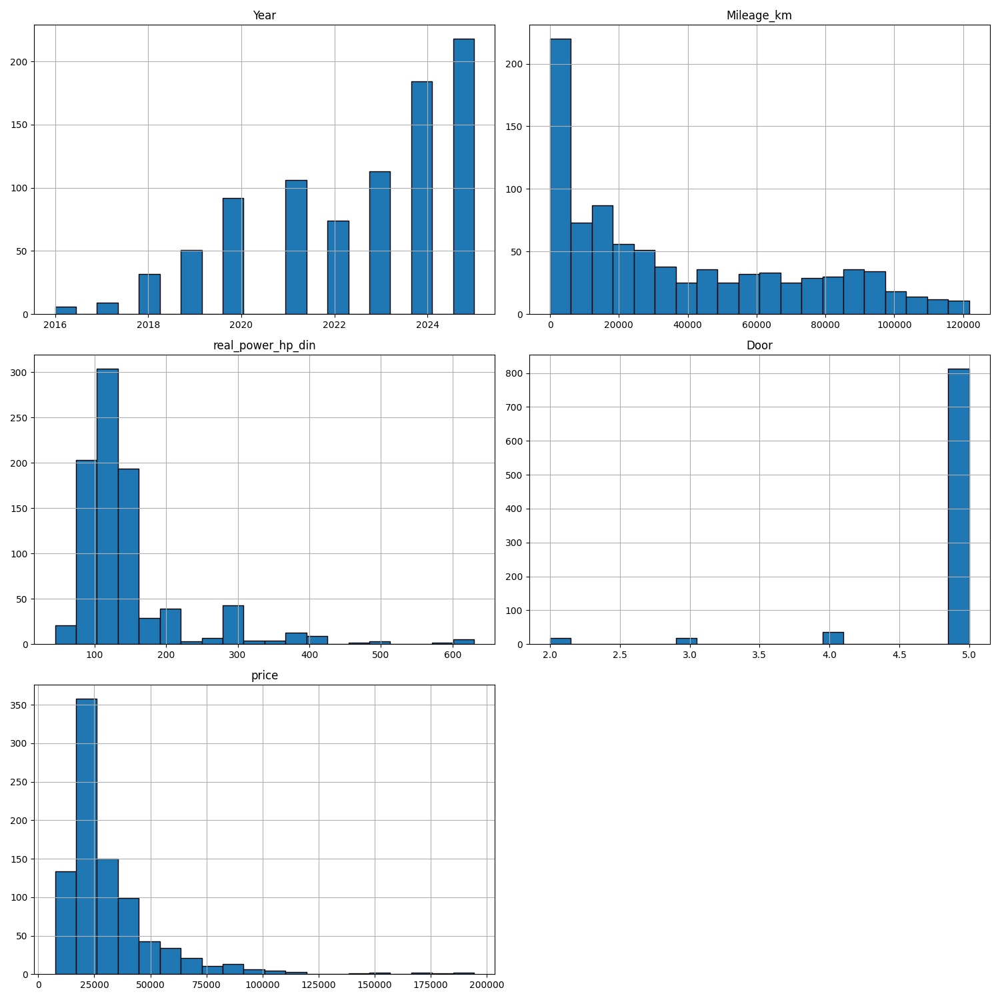
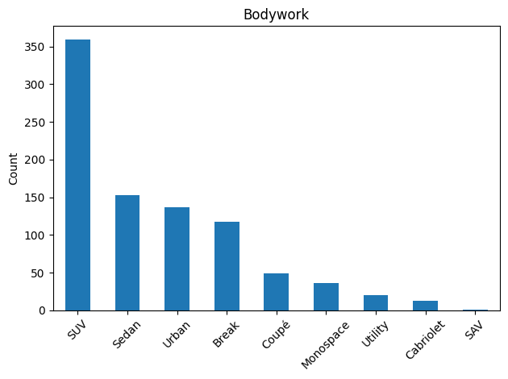
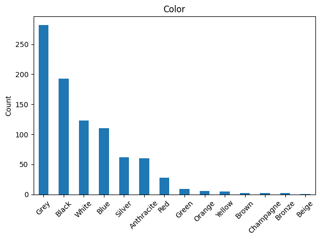
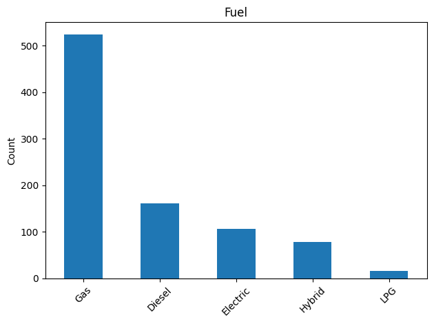
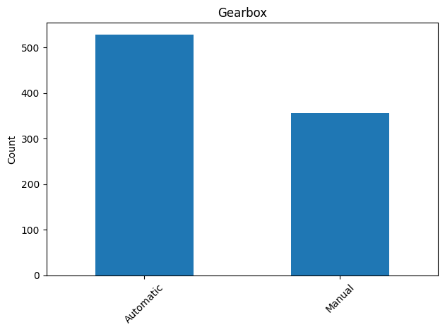
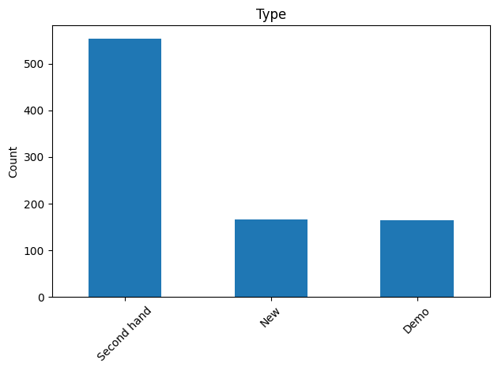

# RAPORT: Predykcja cen samochodów

## Opis procesu zbierania danych

Dane zostały zebrane z jednego z popularnych serwisów ogłoszeniowych dotyczących sprzedaży samochodów. Proces ekstrakcji danych został przeprowadzony za pomocą skryptu `scrapper.py`, a następnie dane zostały wczytane i przetworzone w pliku `prepare_data.ipynb`.

- Liczba wszystkich ogłoszeń przed oczyszczeniem: `1231`.
- Po usunięciu duplikatów i niekompletnych rekordów pozostało `885` unikalnych, kompletnych wpisów.

## Zastosowane transformacje zmiennych

### Duplikaty i brakujące wartości
- Usunięto duplikaty na podstawie identyfikatora `vehicle reference`.
- Wartości `'Data not available'`, `'Other'` oraz `'Not defined'` zostały zamienione na brakujące dane (NaN).
- Usunięto kolumny `CO2` i `CO2 WLTP` z dużą liczbą braków danych.
- Usunięto kolumny `Mixed consumption` oraz `Availability date`, które zawierały tylko jedną unikalną wartość.
- Usunięto obserwacje z brakami danych w kluczowych kolumnach kategorycznych: `Fuel`, `Bodywork`, `Color`.

### Transformacje zmiennych:

- Kolumnę `Price all taxes included` przekształcono do formatu liczbowego jako `price`.
- Kolumnę `Door` przekonwertowano do  (`int`).
- Kolumnę `Mileage` zamieniono na `Mileage_km` zawierającą przebieg w kilometrach (`int`).
- Datę produkcji `Release` przekształcono do formatu `datetime`.
- Kolumny `Fiscal power` i `Real power` przekonwertowano do liczb całkowitych jako `fiscal_power_hp` oraz `real_power_hp_din`.
- Usunięto oryginalne kolumny pomocnicze po transformacji.
  
- Kolumna `equipments` została sparsowana do list za pomocą `ast.literal_eval`.
- Następnie przekształcono ją do reprezentacji binarnej (jeden sprzęt = jedna kolumna) z użyciem `MultiLabelBinarizer`.
- Wynik zapisano do osobnego pliku `equipments_binarized.csv`.

## Statystyki opisowe
|       |       Year |   Mileage_km |   real_power_hp_din |       Door |    price |
|:------|-----------:|-------------:|--------------------:|-----------:|---------:|
| count |  885       |        885   |            885      | 885        |    885   |
| mean  | 2022.55    |      36837.4 |            147.181  |   4.8565   |  31817.1 |
| std   |    2.23945 |      34829.4 |             81.6757 |   0.536849 |  22572.7 |
| min   | 2016       |          0   |             45      |   2        |   7490   |
| 25%   | 2021       |       6152   |            102      |   5        |  18990   |
| 50%   | 2023       |      25000   |            116      |   5        |  24990   |
| 75%   | 2024       |      63881   |            150      |   5        |  36990   |
| max   | 2025       |     121747   |            630      |   5        | 194310   |

## Rozkłady zmiennych numerycznych


## Rozkłady zmiennych kategorycznych







## Historia budowy modelu regresji

- Do budowy modelu predykcji ceny wykorzystano regresję liniową przy użyciu biblioteki `statsmodels` i pakietu scikit-learn. 
- Dane zostały podzielone na zbiór treningowy i testowy (80/20)
- Przetestowano kilka wariantów zmiennych niezależnych, dla każdego z wariantów policzono średni błąd bezwzględny (MAE) i R² na danych testowych

| Nr | Formuła                                                                                                          | R²           | MAE         |
|----|------------------------------------------------------------------------------------------------------------------|--------------|-------------|
| 0  | price ~ Year + Mileage_km + real_power_hp_din                                                                    | 0.852979     | 6316.74     |
| 1  | price ~ Year + Mileage_km + real_power_hp_din + C(Fuel)                                                          | 0.861973     | 6025.7      |
| 2  | price ~ Year + Mileage_km + real_power_hp_din + C(Fuel) + C(Bodywork)                                            | 0.858761     | 6121.86     |
| 3  | price ~ Year + Mileage_km + real_power_hp_din + C(Fuel) + C(Color, levels=all_colors) + C(Gearbox) + C(Bodywork) | 0.856879     | 6124.15     |
| 4  | price ~ Year + Mileage_km + real_power_hp_din + C(Fuel) + C(Gearbox)                                             | 0.864818     | 5884.22     |
| 5  | price ~ Year + Mileage_km + real_power_hp_din + C(Fuel) + C(Gearbox) + C(Bodywork)                               | 0.861445     | 6001.48     |
| 6  | price ~ Year + Mileage_km + real_power_hp_din + C(Fuel) + C(Type)                                                | 0.876361     | 5636.39     |
| 7  | price ~ Year + Mileage_km + real_power_hp_din + C(Fuel) + C(Type) + C(Bodywork)                                  | 0.873702     | 5763.28     |
| 8  | price ~ Year + Mileage_km + real_power_hp_din + C(Fuel) + C(Type) + C(Bodywork) + C(Gearbox)                     | 0.875817     | 5655.6      |
| 9  | **price ~ Year + Mileage_km + real_power_hp_din + C(Fuel) + C(Type) + C(Gearbox)**                               | **0.878653** | **5528.57** |
| 10 | price ~ Year + Mileage_km + real_power_hp_din + C(Type)                                                          | 0.868563     | 5890.86     |
| 11 | price ~ Year + Mileage_km + real_power_hp_din + Door                                                             | 0.854067     | 6289.47     |


## Końcowy model regresji użyty w aplikacji

```
price ~ Year + Mileage_km + real_power_hp_din + C(Fuel) + C(Type) + C(Gearbox)
                             OLS Regression Results                            
==============================================================================
Dep. Variable:                  price   R-squared:                       0.865
Model:                            OLS   Adj. R-squared:                  0.863
Method:                 Least Squares   F-statistic:                     447.6
Date:                Sun, 29 Jun 2025   Prob (F-statistic):          1.51e-295
Time:                        14:29:02   Log-Likelihood:                -7374.9
No. Observations:                 708   AIC:                         1.477e+04
Df Residuals:                     697   BIC:                         1.482e+04
Df Model:                          10                                         
Covariance Type:            nonrobust                                         
==========================================================================================
                             coef    std err          t      P>|t|      [0.025      0.975]
------------------------------------------------------------------------------------------
Intercept              -2.264e+06   6.24e+05     -3.627      0.000   -3.49e+06   -1.04e+06
C(Fuel)[T.Electric]    -1.552e+04   1390.898    -11.162      0.000   -1.83e+04   -1.28e+04
C(Fuel)[T.Gas]         -3277.7273    858.174     -3.819      0.000   -4962.642   -1592.812
C(Fuel)[T.Hybrid]       1237.8926   1324.348      0.935      0.350   -1362.297    3838.082
C(Fuel)[T.LPG]         -2318.2239   2373.987     -0.977      0.329   -6979.247    2342.799
C(Type)[T.New]          4348.9987   1034.011      4.206      0.000    2318.848    6379.149
C(Type)[T.Second hand] -4026.4811   1015.203     -3.966      0.000   -6019.704   -2033.258
C(Gearbox)[T.Manual]   -1597.2591    750.462     -2.128      0.034   -3070.696    -123.822
Year                    1122.3190    308.190      3.642      0.000     517.228    1727.410
Mileage_km                -0.0722      0.019     -3.811      0.000      -0.109      -0.035
real_power_hp_din        232.0279      4.835     47.986      0.000     222.534     241.521
==============================================================================
Omnibus:                      170.672   Durbin-Watson:                   2.054
Prob(Omnibus):                  0.000   Jarque-Bera (JB):             6430.136
Skew:                           0.198   Prob(JB):                         0.00
Kurtosis:                      17.759   Cond. No.                     1.04e+08
==============================================================================
```
Model osiągnął następujące wyniki na zbiorze testowym:
- Średni błąd bezwzględny (MAE):  **5810 EUR**
- R² (współczynnik determinacji): **0.83**

### Jakość modelu
| Statystyka           | Wartość       | Interpretacja                                           |
|----------------------|---------------|---------------------------------------------------------|
| R-squared            | **0.865**     | Model wyjaśnia 86,5% zmienności zmiennej `price`        |
| Adj. R-squared       | **0.863**     | Skorygowany współczynnik — uwzględnia liczbę zmiennych. |
| F-statistic          | **447.6**     | Cały model jest istotny statystycznie.                  |
| Prob (F-statistic)   | **1.51e-295** | p < 0.001 — bardzo silna istotność całego modelu.       |
| No. Observations     | **708**       | Liczba rekordów użytych do trenowania modelu            |
| Df Model / Residuals | 10 / 697      | Liczba zmiennych + liczba stopni swobody reszt.         |

### Interpretacja współczynników regresji
| Zmienna                 | Wartość współczynnika | p-value   | Interpretacja                                                                                  |
|-------------------------|-----------------------|-----------|------------------------------------------------------------------------------------------------|
| Intercept               | -2 264 000            | **0.000** | Przeciętny poziom cen przy wszystkich zmiennych kategorycznych ustawionych jako referencyjne.  |
| C(Fuel)\[T.Electric]    | -15 520               | **0.000** | Samochody elektryczne są średnio tańsze o \~15 tys. EUR w porównaniu do referencyjnego paliwa. |
| C(Fuel)\[T.Gas]         | -3 278                | **0.000** | Samochody na benzynę są nieco tańsze niż referencja (np. diesel).                              |
| C(Fuel)\[T.Hybrid]      | +1 238                | 0.350     | Brak istotności statystycznej – efekt może być przypadkowy.                                    |
| C(Fuel)\[T.LPG]         | -2 318                | 0.329     | Również brak istotności statystycznej.                                                         |
| C(Type)\[T.New]         | +4 349                | **0.000** | Nowe auta są droższe o ok. 4349 EUR względem referencji (np. pojazdy demonstracyjne).          |
| C(Type)\[T.Second hand] | -4 026                | **0.000** | Auta używane są tańsze o \~4026 EUR niż referencja.                                            |
| C(Gearbox)\[T.Manual]   | -1 597                | **0.034** | Skrzynia manualna obniża cenę względem automatycznej.                                          |
| Year                    | +1 122                | **0.000** | Każdy dodatkowy rok podnosi średnią cenę auta o \~1122 EUR.                                    |
| Mileage\_km             | -0.072                | **0.000** | Każdy dodatkowy kilometr przebiegu zmniejsza cenę o 7 eurocentów.                              |
| real\_power\_hp\_din    | +232.03               | **0.000** | Każdy dodatkowy koń mechaniczny zwiększa cenę auta o \~232 EUR.                                |

